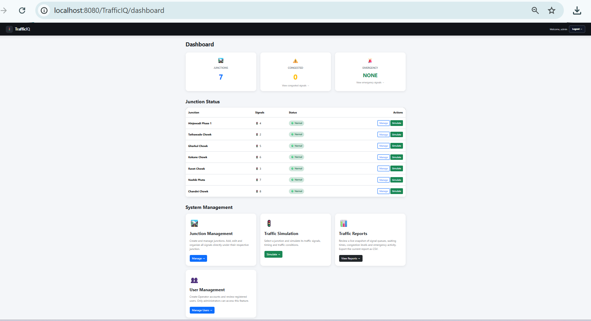

# TrafficIQ --- Smart Traffic Signal Optimization & Congestion Analytics

TrafficIQ is a Java-based web application for managing traffic junctions
and signals, viewing traffic-simulation information, and reviewing
congestion-related reports.

> **Project status:** Academic/portfolio project. Features and setup
> instructions below describe the current project structure as
> developed; verify environment-specific configuration before running it
> on another machine.

## Features

-   **Dashboard:** Overview of junctions and traffic-related metrics.
-   **Junction management:** Add, view, edit, and delete junctions.
-   **Signal management:** Configure signals for a junction, including
    direction, green/yellow/red timing, and status.
-   **Traffic simulation:** View signal states and use the simulation
    controls available in the application.
-   **Traffic reports:** Review signal and congestion summaries and
    filter report data.
-   **User management:** Administrator-restricted account management.
-   **Database integration:** Store and retrieve application data using
    MySQL.

## Technology Stack

  Technology               Purpose
  ------------------------ ------------------------------------------------
  Java                     Server-side application logic
  Jakarta Servlets         Handle HTTP requests and application workflows
  JSP (JavaServer Pages)   Render dynamic web pages
  HTML5                    Page structure
  CSS3                     Styling and layout
  Bootstrap 5              Responsive UI components
  MySQL                    Relational database
  JDBC                     Java-to-database connectivity
  Maven                    Dependency management and WAR packaging
  Apache Tomcat            Servlet/JSP application server

JavaScript is used where included in the client-side simulation
interface.

## Application Areas

-   Dashboard
-   Junction Management
-   Junction-specific Signal Management
-   Traffic Simulation
-   Traffic Reports
-   Admin User Management

## Project Structure

The project follows a Maven web-application layout. Your exact folders
may vary slightly as the project evolves.

``` text
TrafficIQ/
├── pom.xml
└── src/
    └── main/
        ├── java/
        │   └── com/
        │       └── trafficiq/
        │           ├── controller/
        │           ├── dao/
        │           ├── model/
        │           └── service/
        └── webapp/
            ├── dashboard/
            ├── junction/
            ├── simulation/
            ├── admin/
            ├── css/
            ├── js/
            └── WEB-INF/
```

-   `controller/` --- servlet controllers and request handling.
-   `dao/` --- database access logic.
-   `model/` --- application data models such as `Junction`, `Signal`,
    and `User`.
-   `service/` --- application/business logic where implemented.
-   `webapp/` --- JSP pages and frontend assets.

## Prerequisites

Install and configure:

-   A compatible JDK (the project has been developed with modern JDK
    versions).
-   Apache Maven.
-   MySQL Server.
-   Apache Tomcat compatible with the Jakarta Servlet version used by
    the project.
-   IntelliJ IDEA or another Java IDE.

The project has used Jakarta Servlet API 6.x and Tomcat 11 during
development. Check `pom.xml` and your local server configuration for the
exact versions required by your checkout.

## Setup and Run

### 1. Clone the repository

``` bash
git clone https://github.com/SalemS16/TrafficIQ.git
cd TrafficIQ
```

### 2. Configure the database

1.  Start MySQL Server.
2.  Create the database used by the project (the development database
    name has been `trafficiq`).
3.  Create the required tables using your project's SQL scripts or
    schema definitions.
4.  Update the database connection settings in the project to match your
    local MySQL username, password, host, and port.

**Do not commit database passwords or other secrets to GitHub.** Use
local configuration or environment-specific settings for credentials.

> The exact schema and database configuration file can differ by
> checkout. Review the DAO/database connection code before running the
> application.

### 3. Build the project

From the directory containing `pom.xml`, run:

``` bash
mvn clean package
```

Maven should build a WAR file under `target/` if the project is
configured correctly.

### 4. Deploy to Tomcat

1.  Deploy the generated WAR to your configured Tomcat instance, or
    configure a Tomcat run configuration in your IDE.
2.  Start Tomcat.
3.  Open the application using the context path assigned by your
    deployment. During development, the context path has been
    `/TrafficIQ`, for example:

``` text
http://localhost:8080/TrafficIQ/
```

If the application uses a different context path on your machine,
replace `/TrafficIQ` accordingly.

### 5. Sign in

Use an administrator account that has already been created in your
configured database. Do not publish real passwords in this README or in
the repository.

## Security and Configuration Notes

-   Keep database credentials and private configuration out of source
    control.
-   Use administrator-only access for user-management operations.
-   Use password hashing and server-side validation as implemented in
    the project.
-   For a public deployment, review session handling, authorization
    checks, CSRF protection, input validation, and error handling before
    exposing the application to the internet.

## Screenshots

Add screenshots of the working application here to make the repository
easier to explore.

Suggested screenshots:

1.  Dashboard
2.  Junction Management
3.  Junction Signal Management
4.  Traffic Simulation
5.  Traffic Reports
6.  Admin User Management

For example, create a `screenshots/` folder in the repository and add
images, then reference them like this:

``` markdown

```

Only add screenshots that match the current version of the application.

## Future Improvements

Possible future enhancements include:

-   Persisting historical simulation data for trend analysis.
-   Adding more detailed traffic analytics and visualizations.
-   Improving automated tests and deployment documentation.
-   Adding role-based permissions for additional user types.
-   Deploying a demo environment with safe, non-production data.

These are potential enhancements, not claims about existing
functionality.

## Author

**Salem Saudagar**

-   GitHub: [SalemS16](https://github.com/SalemS16)
-   Project repository:
    [TrafficIQ](https://github.com/SalemS16/TrafficIQ)

------------------------------------------------------------------------


